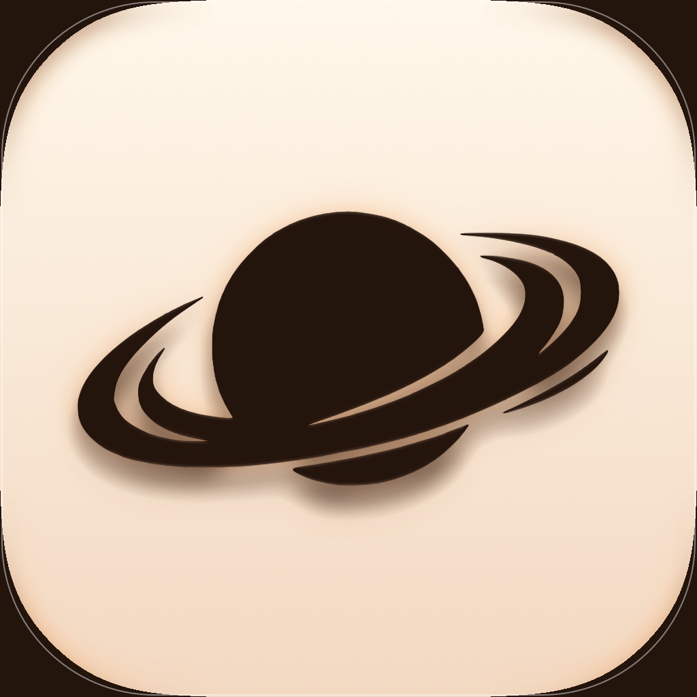

<p align="center">
  
</p>

<h1 align="center">Xorssaint Utils · 个人 Fork（非官方）</h1>

<p align="center">
  菜单栏里的 macOS 工具集合。<br>
  基于 <a href="https://github.com/vorssaint/vorssaint-utils">vorssaint/vorssaint-utils</a> 的非官方个人分支。
</p>

<p align="center">
  
  
</p>

> [!IMPORTANT]
> **这是非官方 fork，与原作者 Vorssaint 没有隶属关系。**
> 上游的官网、Homebrew cask 和发布包都指向官方版本；本仓库的修改不会进入官方版本。
> 如果你需要稳定、已签名并公证的官方版，请使用 [上游仓库](https://github.com/vorssaint/vorssaint-utils)。

## 这个 fork 做了什么

当前代码基于上游 **3.4.4** 之后的 `faada18d`（2026-11-18），以及此后的本地修改。上游的功能全部保留，本 fork 额外加入：

### 菜单栏日期时间

- 默认开启，空闲时用日期时间替代菜单栏图标。
- 默认格式 `y年M月dd日 E HH:mm:ss`，支持 Unicode TR35 自定义格式，可一键恢复默认。
- 字号可选 12–16 pt，13 pt 接近系统菜单栏字号。
- 格式包含秒时按秒刷新，不包含秒时按分钟刷新。
- 有更新、麦克风静音、Keep Awake 等状态信号时，图标重新出现。
- 可在设置中关闭，恢复原来的图标显示。

### 日历面板

- 日历是菜单面板的第一个 section，默认显示，可单独关闭。
- 支持周一或周日作为一周开始。
- 节假日和调休以彩色圆点标注，不显示悬浮文字。
- 支持切换月份，日期网格按 6 行固定布局对齐。

### CCClip 剪贴板管理器

CCClip 是一个独立于上游剪贴板历史的新功能，灵感来自 [Clipy](https://github.com/Clipy/Clipy)。它不是 Clipy 的完整移植，也不读写上游的剪贴板历史。

- 在 **Features Hub** 中安装后启用，默认不安装。
- 默认只捕获纯文本；可分别开启 RTF、RTFD、PDF、文件、URL、图片和 HTML，共 8 种类型。
- 历史菜单支持分组、计数、⌘1–⌘0 快速选择、首项高亮、缩略图、颜色预览、排序和去重。
- 默认快捷键 ⇧⌘V，可修改或清空；自动粘贴默认开启。
- 片段按文件夹组织，先建文件夹再建片段；文件夹可以设置独立快捷键。
- 数据独立保存在本地，不与上游剪贴板历史或片段混用。
- Clipy 的 MIT 版权说明位于 **设置 → CCClip**。

### 面板与图标

- 可隐藏面板顶部的 Xorssaint 图标，预览同步生效。
- 顶部 section 切换器支持 mini 模式，预览同步生效。
- 应用图标改为暖沙色版本，作为这个非官方分支的视觉标识。

### 菜单栏图标隐藏（macOS 27）

菜单栏图标隐藏由 macOS 27 自己管理。Xorssaint 不再自行隐藏图标，也不使用私有 API。

- 在 **Features Hub** 安装/卸载；安装后出现在 **设置 → 实用工具 → 菜单栏图标隐藏**。
- 页面提供说明和「打开系统设置」按钮。
- 按钮按系统版本启用：macOS 27 及以上可用，macOS 26 及更早版本置灰。
- 具体隐藏哪些 App、系统项是否显示，由 macOS 系统设置控制。

### 访达右键编辑任意图片

- 在访达里右键任意图片，选择「服务 → 用 Xorssaint 编辑」，直接用截图编辑器打开它，不必先截屏。
- 编辑后按 ⌘S 保存在**原文件所在目录**，文件名按导出格式生成并自动编号，既不会覆盖原图，也不会覆盖先前的导出。
- 多选时只处理第一张。服务菜单的中英文名称可在 `Resources/*/ServicesMenu.strings` 里调整。

### 截图编辑器外观

- 编辑器跟随应用的整体外观，设置里新增「编辑器外观」，可以单独固定为浅色或深色。
- 「跟随应用」与应用的浅色/深色设置保持一致，而不是直接跟随系统 —— 应用被固定成浅色时，编辑器也应是浅色。

### 截图取色器

- 工具栏新增「取色」工具，指针在画布上时，放大镜与色值读数跟着指针走。
- 读数条给出指针下像素的色块、按取色器既有格式（HEX/RGB/HSL）写出的色值，以及像素坐标；点击把颜色复制到剪贴板。
- 取色只读截图原图的像素，已经画上去的标注不参与采样。

### 没有改动

- 上游的剪贴板历史、文本片段、快捷键和其他功能仍然保留。
- CCClip 使用独立存储和独立设置；安装或卸载 CCClip 不会迁移或删除上游的剪贴板数据。

## 上游功能

Xorssaint 把音量混音、系统监控、窗口管理、Dock 预览、截图与录屏、剪贴板历史、文件架、卸载器、Homebrew 管理等工具收进一个菜单栏图标，并按需安装。完整功能列表、截图和隐私说明请看[上游 README](https://github.com/vorssaint/vorssaint-utils#readme)。

本 README 只维护与上游不同的部分，避免两份功能列表长期不同步。

## 安装

本 fork 不提供经过 Apple Developer ID 签名和公证的安装包。`brew install --cask vorssaint` 安装的是**上游官方版**，不是这个仓库。

### 环境要求

- Apple Silicon Mac
- macOS 14 Sonoma 或更新版本
- Xcode Command Line Tools：`xcode-select --install`

### 从源码构建

```sh
git clone https://github.com/ShuangCAO/xorssaint-utils.git
cd xorssaint-utils

# Developer 变体：独立 bundle id，可以和官方版共存
./build.sh --dev
./build.sh --dev --install

# Release 变体：使用 com.xorssaint.utils，和官方版冲突
./build.sh
./build.sh --install
```

第一次使用建议先构建 Developer 变体。它使用 `com.xorssaint.utils.dev`，权限和设置与官方版、Release 变体互相独立。

### 测试与安装包

```sh
./build.sh --test          # 运行测试
./build.sh                 # Release 构建
./Tools/make-dmg.sh        # 生成 dist/Xorssaint-<version>.dmg
```

如果 Releases 中有 DMG，那是本 fork 自行构建的未公证版本；首次打开可能需要在 **系统设置 → 隐私与安全性** 中允许。

### 卸载

把 App 移到废纸篓，并按需删除对应的 Application Support 目录：

- Release：`~/Library/Application Support/com.xorssaint.utils`
- Developer：`~/Library/Application Support/com.xorssaint.utils.dev`

## 权限与数据

CCClip 的自动粘贴需要**辅助功能**权限；如果全局快捷键不生效，也请检查 **系统设置 → 隐私与安全性 → 辅助功能**。上游其他功能按需申请屏幕录制、输入监控、自动化、麦克风和相机等权限，完整说明见[权限文档](docs/PERMISSIONS.md)。

CCClip 的数据保存在：

```text
~/Library/Application Support/<bundle id>/Clipy
```

其中 Release 的 bundle id 是 `com.xorssaint.utils`，Developer 是 `com.xorssaint.utils.dev`。目录和文件权限为仅当前用户可读写。

本 fork 没有为新增功能加入账号、云同步或遥测。CCClip 的剪贴板内容只保存在本地；默认只捕获纯文本，可以在设置中关闭捕获或清空历史。

首次从旧的 Vorssaint 版本启动时，应用会把旧 `com.vorssaint.utils[.dev]` 的设置和 Application Support 目录复制到新的 Xorssaint bundle，旧数据保留不删。辅助功能、屏幕录制等系统权限与 Bundle ID 绑定，需要重新授权。

自动更新、截图/录屏分享链接和反馈上传在本 fork 中已禁用；截图和录屏本身仍然完全本地可用。

## 与上游同步

本仓库的 `main` 跟随上游 `main`，本地功能提交保持在上游之上，不向上游推送。

上游与本 fork 改动到同一处文件时需要手动解决冲突，解决后重新构建并运行测试。

## 已知限制

- CCClip 是独立实现，不导入 Clipy 的历史或配置，也不保证与 Clipy 行为完全一致。
- 默认只捕获纯文本；其他类型需要在 CCClip 设置中手动开启。
- 自动更新已禁用；更新方式是从源码重新构建，或手动下载你自己发布的构建。
- 截图/录屏分享链接和反馈上传已禁用，只保留本地截图、录屏和系统分享面板。
- 没有 Apple Developer ID 签名和公证，公开分发前需要自行处理签名、Bundle ID 和商标问题。
- 仅支持 Apple Silicon 和 macOS 14 及以上。
- 上游部分功能依赖具体硬件、macOS 版本或额外权限。
- ⌘Q 不再退出本应用；用菜单栏图标右键的「退出 Xorssaint」，或面板底部的退出按钮。
- 访达的「服务」菜单项需要应用安装在 /Applications 并被 LaunchServices 登记后才会出现。

## 分发注意

上游的 [TRADEMARKS.md](TRADEMARKS.md) 要求非官方 fork 在对外分发时使用不同的名称、App 图标、Bundle ID、签名身份和更新源。当前仓库主要用于个人源码构建；如果你要公开发布二进制，请先按该文件完成品牌和标识替换，避免被误认为官方版本。

## 文档

- [上游 README](https://github.com/vorssaint/vorssaint-utils#readme)
- [隐私说明](docs/PRIVACY.md)
- [权限说明](docs/PERMISSIONS.md)
- [故障排查](docs/TROUBLESHOOTING.md)
- [贡献指南](CONTRIBUTING.md)
- [许可证](LICENSE)
- [商标说明](TRADEMARKS.md)

## 许可证与致谢

- 原始项目：[vorssaint/vorssaint-utils](https://github.com/vorssaint/vorssaint-utils)，© 2026 Vorssaint，GPL-3.0-or-later。
- 本 fork 的修改：© 2026 ShuangCAO 及贡献者，同样以 GPL-3.0-or-later 发布。
- 上游项目 Vorssaint 的名称、Logo 和视觉标识归上游所有，并受 [TRADEMARKS.md](TRADEMARKS.md) 约束；Xorssaint 是非官方分支名称。
- CCClip 的交互灵感来自 [Clipy](https://github.com/Clipy/Clipy)（MIT）；相关版权说明见 **设置 → CCClip**。
- 感谢上游所有贡献者。

## English

This is an unofficial personal fork of [Vorssaint Utils](https://github.com/vorssaint/vorssaint-utils). It keeps the upstream feature set and adds a configurable menu bar clock, a calendar panel, **CCClip** (an independent clipboard manager inspired by [Clipy](https://github.com/Clipy/Clipy)), a menu bar icon hiding entry for macOS 27, editing any picture from Finder's Services menu, a separate appearance choice for the screenshot editor, and an eyedropper that reads the colour under the pointer.

Build from source with Xcode Command Line Tools:

```sh
git clone https://github.com/ShuangCAO/xorssaint-utils.git
cd xorssaint-utils
./build.sh --dev
./build.sh --dev --install
```

This fork is not affiliated with the upstream project. The upstream Vorssaint name and visual identity belong to the upstream authors; Xorssaint is an unofficial fork name. Original code is GPL-3.0-or-later; fork modifications are released under the same license.